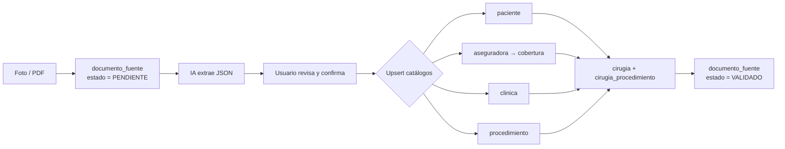

# Arquitectura de datos — App Anestesiólogos

La información se extrae de una **foto o PDF** de la orden quirúrgica y alimenta
una base de datos relacional (PostgreSQL) unida por llaves primarias/foráneas.
El esquema ejecutable está en [`db/schema.sql`](../db/schema.sql).

## Diagrama entidad-relación


## Tablas y decisiones de diseño

| Tabla | Qué guarda | Por qué así |
|---|---|---|
| `paciente` | Id (tipo + número de documento) y nombre | El documento es único: si el paciente vuelve, se reutiliza su registro. |
| `aseguradora` | EPS, prepagada o póliza (campo `tipo`) | Una sola tabla para los tres tipos; evita tres tablas casi iguales. |
| `cobertura` | Qué aseguradora tiene cada paciente y su nº de póliza/afiliación | Un paciente puede tener EPS **y** prepagada a la vez. |
| `clinica` | Dónde se hace el procedimiento | Catálogo reutilizable. |
| `procedimiento` | Catálogo de códigos CUPS + nombre | El código es la llave primaria natural. |
| `cirugia` | **Tabla central**: une paciente, cobertura, clínica, anestesiólogo y fecha | Cada foto/PDF genera un registro aquí. |
| `cirugia_procedimiento` | Códigos de una cirugía | Una orden suele traer varios códigos (ej. principal + adicional). |
| `documento_fuente` | Archivo original + JSON extraído por la IA | Trazabilidad: se puede revisar qué leyó la IA y corregir. |
| `anestesiologo` | Usuario de la app | Cada anestesiólogo ve solo sus cirugías. |

## Flujo: de la foto a la base de datos



### JSON que devuelve la extracción

```json
{
  "paciente":    { "tipo_documento": "CC", "numero_documento": "1020304050",
                   "nombres": "María Fernanda", "apellidos": "Gómez Ruiz" },
  "aseguradora": { "nombre": "Sura", "tipo": "PREPAGADA", "numero_poliza": "PP-778812" },
  "clinica":     { "nombre": "Clínica Las Américas", "ciudad": "Medellín" },
  "procedimientos": [
    { "codigo": "470100", "nombre": "Apendicectomía", "es_principal": true }
  ],
  "fecha_procedimiento": "2026-10-15",
  "confianza": 0.94
}
```

Cada bloque del JSON se mapea a una tabla: `paciente` → `paciente`,
`aseguradora` → `aseguradora` + `cobertura`, `clinica` → `clinica`,
`procedimientos[]` → `procedimiento` + `cirugia_procedimiento`, y la fecha → `cirugia`.
