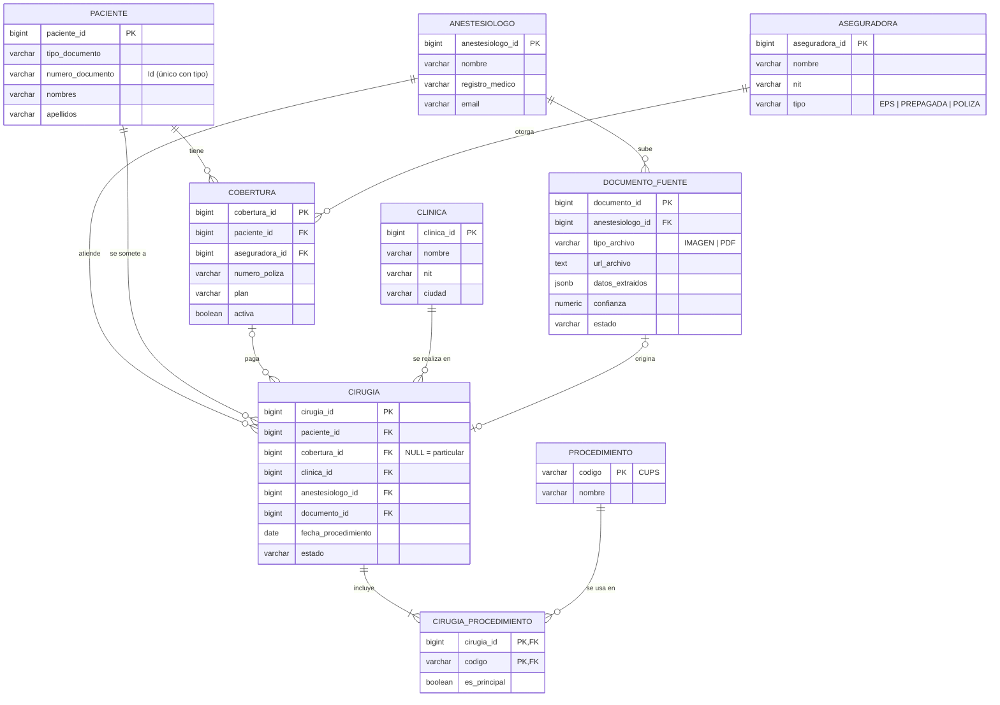
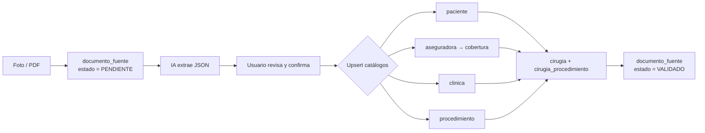
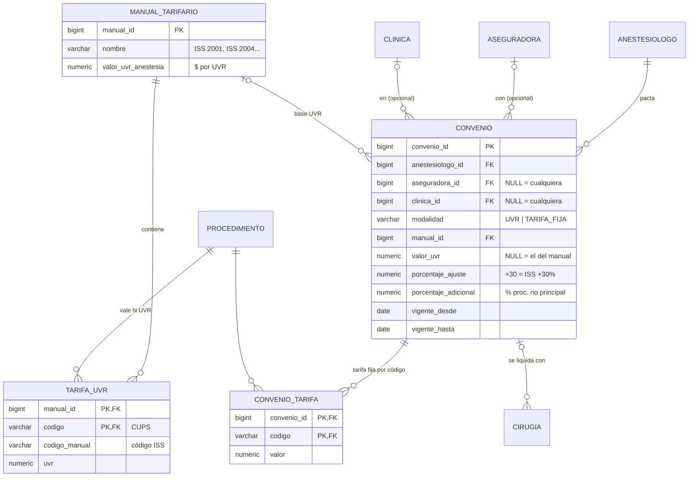

# Arquitectura de datos — App Anestesiólogos

La información se extrae de una **foto o PDF** de la orden quirúrgica y alimenta
una base de datos relacional (PostgreSQL) unida por llaves primarias/foráneas.
El esquema ejecutable está en [`db/schema.sql`](../db/schema.sql) y el módulo de
honorarios en [`db/honorarios.sql`](../db/honorarios.sql) (se ejecuta después).

## Diagrama entidad-relación



## Tablas y decisiones de diseño

| Tabla | Qué guarda | Por qué así |
|---|---|---|
| `paciente` | Id (tipo + número de documento) y nombre | El documento es único: si el paciente vuelve, se reutiliza su registro. |
| `aseguradora` | EPS, prepagada o póliza (campo `tipo`) | Una sola tabla para los tres tipos; evita tres tablas casi iguales. |
| `cobertura` | Qué aseguradora tiene cada paciente y su nº de póliza/afiliación | Un paciente puede tener EPS **y** prepagada a la vez. |
| `clinica` | Dónde se hace el procedimiento | Catálogo reutilizable. |
| `procedimiento` | Catálogo de códigos CUPS + nombre | El código es la llave primaria natural. |
| `cirugia` | **Tabla central**: une paciente, cobertura, clínica, anestesiólogo y fecha | Cada foto/PDF genera un registro aquí. |
| `cirugia_procedimiento` | Códigos de una cirugía | Una orden suele traer varios códigos (ej. principal + adicional). |
| `documento_fuente` | Archivo original + JSON extraído por la IA | Trazabilidad: se puede revisar qué leyó la IA y corregir. |
| `anestesiologo` | Usuario de la app | Cada anestesiólogo ve solo sus cirugías. |

## Flujo: de la foto a la base de datos



### JSON que devuelve la extracción

```json
{
  "paciente":    { "tipo_documento": "CC", "numero_documento": "1020304050",
                   "nombres": "María Fernanda", "apellidos": "Gómez Ruiz" },
  "aseguradora": { "nombre": "Sura", "tipo": "PREPAGADA", "numero_poliza": "PP-778812" },
  "clinica":     { "nombre": "Clínica Las Américas", "ciudad": "Medellín" },
  "procedimientos": [
    { "codigo": "470100", "nombre": "Apendicectomía", "es_principal": true }
  ],
  "fecha_procedimiento": "2026-10-15",
  "confianza": 0.94
}
```

Cada bloque del JSON se mapea a una tabla: `paciente` → `paciente`,
`aseguradora` → `aseguradora` + `cobertura`, `clinica` → `clinica`,
`procedimientos[]` → `procedimiento` + `cirugia_procedimiento`, y la fecha → `cirugia`.

## Módulo de honorarios

Permite que cada anestesiólogo vea cuánto le van a pagar por cirugía, según la
aseguradora y/o la clínica.



### Cómo se calcula

1. **Se busca el convenio** (`buscar_convenio`), del más específico al más general:
   aseguradora + clínica → solo aseguradora → solo clínica → convenio general.
   Solo cuentan convenios vigentes en la fecha del procedimiento.
2. **Se calcula cada código** de la cirugía (`calcular_honorarios`):
   - `UVR`: `UVR del código × valor UVR × (1 + ajuste %) × porcentaje`
   - `TARIFA_FIJA`: `valor pactado × porcentaje`
   - `porcentaje` = 100 % para el procedimiento principal y `porcentaje_adicional`
     (50 % por defecto, configurable por convenio) para los demás.
3. **Se guarda una copia del valor calculado** en `cirugia_procedimiento` y `cirugia.valor_honorarios`. Si mañana
   cambia la tabla UVR o el convenio, lo ya liquidado no se altera. Basta volver a
   llamar `calcular_honorarios(id)` para recalcular a propósito.
4. Si un código no tiene tarifa, `honorarios_completos = FALSE` y la cirugía
   aparece en la columna `sin_tarifa` del tablero para que el usuario la complete.

Ejemplo (valores ilustrativos): código con 100 UVR, ISS 2001 a $960/UVR,
convenio EPS "ISS + 30 %" → `100 × 960 × 1,30 = $124.800`.
Un segundo código de 50 UVR al 50 % → `50 × 960 × 1,30 × 0,5 = $31.200`.
Total cirugía: **$156.000**.

### Tablero del anestesiólogo

La vista `v_honorarios` agrupa por mes, clínica y aseguradora:
`cirugias`, `total`, `pagado`, `por_cobrar` y `sin_tarifa`.

```sql
SELECT * FROM v_honorarios
 WHERE anestesiologo_id = 1 AND mes = '2026-10-01';
```

### Cargar la tabla UVR

La tabla del manual (ej. ISS 2001) se carga desde un CSV `codigo,codigo_manual,uvr`:

```sql
INSERT INTO manual_tarifario (nombre, valor_uvr_anestesia) VALUES ('ISS 2001', <valor>);
\copy tarifa_uvr (manual_id, codigo, codigo_manual, uvr) FROM 'iss2001.csv' CSV HEADER
```

> Los manuales ISS usan códigos propios, distintos a los CUPS que traen las
> órdenes; por eso `tarifa_uvr` guarda ambos (`codigo` CUPS y `codigo_manual`).
